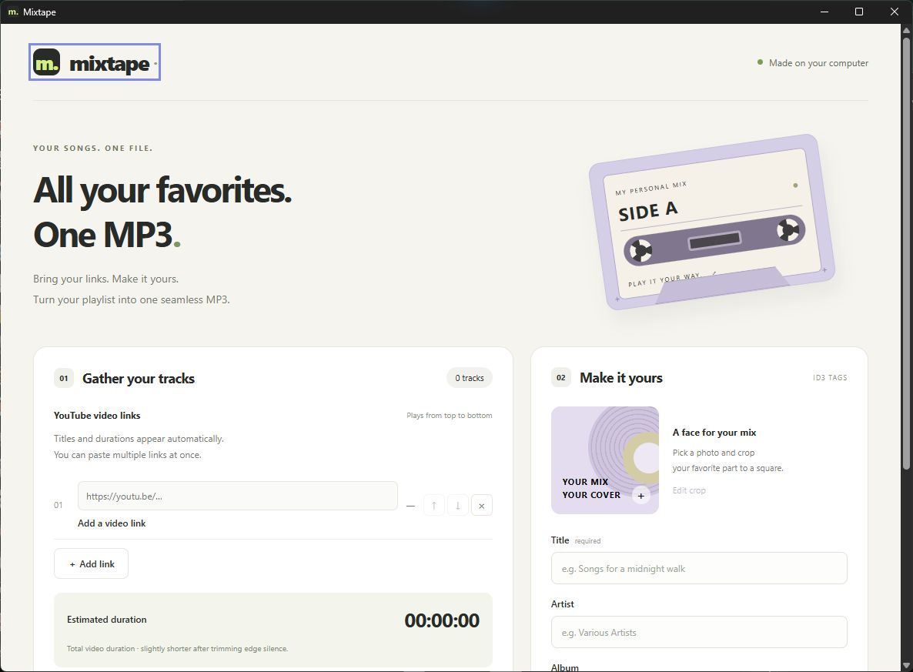

<div align="center">

# Mixtape

**Your playlist. One file.**

Turn a list of YouTube videos into one continuous MP3, with your own title,
artist, album, and square cover art. Made for the music player in your pocket.

[**Download for Windows**](https://github.com/nohseongmin/mixtape-studio/releases/latest) ·
[How it works](#how-it-works) · [Build from source](#build-from-source)



</div>

## What it does

- **One MP3, your whole list.** Combine 1, 300, or more individual video links in
  your chosen order. No one-hour cutoff. Input is limited to 200,000 characters.
- **Automatic video details.** Paste several links or add them one by one. Titles
  and durations appear after you stop typing. Up to four new videos are checked
  concurrently; successful lookups are reused during the current session.
- **Trim the edges.** Remove silence at the beginning and end of each track while
  preserving pauses inside the music. No added gaps, crossfading, or normalization.
- **Make it yours.** Add title, artist, album, and optional cover art. Drag and zoom
  to crop a supported image to an 800 × 800 JPEG square.
- **Choose your bitrate.** 128, 192, 256, or 320 kbps MP3 at 44.1 kHz stereo.
  Higher bitrates use more space; they cannot restore detail absent from the source.
- **One window, one lifetime.** No command prompt or background service to manage.
  Closing the window stops the server, downloads, and converters.
- **A fresh start every time.** Links, video details, tags, cover art, and quality
  selections are not restored after restarting the app.

## Download and run

1. Download **`Mixtape.exe`** from [Releases](https://github.com/nohseongmin/mixtape-studio/releases/latest).
2. Put it in a writable folder of your choice and double-click it.
3. Paste video links, arrange the tracks, add a title, and select your MP3 quality.
4. Click **Create one MP3**. Listen to the result or use **Save MP3** to copy it
   elsewhere. A completed copy stays in `outputs` beside the executable.

The release is a **single Windows x64 executable**, including Python, yt-dlp,
FFmpeg, FFprobe, and Node.js. No terminal installation is needed. Windows 10 22H2
or Windows 11 and the [Microsoft Edge WebView2 Runtime](https://developer.microsoft.com/en-us/microsoft-edge/webview2/)
are required. The runtime is commonly already installed. Other platforms have not
been tested.

The executable is unsigned; its SHA-256 checksum is published with each release.
Startup takes a few seconds while the bundle extracts its tools. Keep enough free
disk space for extracted tools, temporary uncompressed audio, and your finished
MP3. Long lists can require several gigabytes.

## How it works

```text
Video links → automatic titles + durations → your track order
                                               ↓
Best available source audio → trim edge silence → concatenate
                                               ↓
                          one MP3 encode → tags + square cover
```

Only individual YouTube videos are accepted, including `youtu.be`, watch, Shorts,
and completed live-video links. Playlist URLs, scheduled streams, and ongoing
live streams are not supported. Private, restricted, removed, or blocked videos
may be unavailable. Edit, remove, or retry failed rows with **↻**.

The estimate uses reported video lengths. The final duration is shorter when
edge silence is removed. Silence detection uses a −50 dB threshold for intervals
of at least 0.12 seconds. Very quiet introductions or endings may therefore be
trimmed. The final MP3 is encoded once, after concatenation.

## Files and privacy

| Location | Contents |
| --- | --- |
| `Mixtape.exe` | The application and bundled tools |
| `outputs/` | Completed MP3s, retained until you remove them |
| `data/desktop.log` | Rotating diagnostic log |
| `data/webview/` | Local WebView2 runtime profile |
| Temporary job folders in `data/` | Working audio; removed after completion or normal cancellation |

Successful video lookups are reused **only in process memory**. There is no saved
playlist or video metadata database. The app does not restore links, tags, or
images, and disables yt-dlp's disk cache. The WebView2 profile and diagnostic logs
are separate from playlist data. A crash or forced termination may leave temporary
files; close the app before removing its `data` folder.

The UI and processing run locally. Metadata and audio requests still go to
YouTube and its delivery servers over your internet connection. Mixtape has no
account system, analytics endpoint, or cloud upload service. MP3s contain the
tags and cover art you intentionally supplied.

Use only content you own or have permission to download and process, and follow
the source service's terms. Mixtape does not bypass DRM, import account cookies,
or provide access to restricted content. It is not affiliated with YouTube.

## Build from source

Use **64-bit Python 3.12 on Windows**. Clone the repository, then run these commands
from its directory in PowerShell:

```powershell
python -m venv --without-pip .venv
python -m pip --python .venv\Scripts\python.exe install -r requirements-build.txt
.venv\Scripts\python.exe build.py
```

The build downloads the exact tools in `build-tools.json`, verifies their SHA-256
hashes, collects license notices, and runs PyInstaller. Output:

```text
dist/Mixtape.exe
dist/SHA256SUMS.txt
dist/Mixtape-licenses.zip
```

Upstream FFmpeg daily releases have limited retention. If a pinned URL expires,
obtain the same tool from the release's build-input archive and put it in
`build/downloads`; the build still checks its pinned hash. Updating a tool requires
changing its URL and verified hash deliberately.

Run the source version using the downloaded tools:

```powershell
$env:MIXTAPE_FFMPEG = "$PWD\build\tools\ffmpeg.exe"
$env:MIXTAPE_FFPROBE = "$PWD\build\tools\ffprobe.exe"
$env:MIXTAPE_NODE = "$PWD\build\tools\node.exe"
.venv\Scripts\pythonw.exe Mixtape.pyw
```

Alternatively, install FFmpeg/FFprobe and Node.js on `PATH`, run `setup.cmd`, and
use the generated desktop shortcut. Source launchers use a virtual environment;
the downloadable EXE does not.

### Configuration

Defaults live in `config.py`. Optional environment overrides:

| Variable | Purpose |
| --- | --- |
| `MIXTAPE_DATA_DIR` | Working files, log, and WebView2 profile |
| `MIXTAPE_OUTPUT_DIR` | Completed MP3 directory |
| `MIXTAPE_FFMPEG`, `MIXTAPE_FFPROBE`, `MIXTAPE_NODE` | Alternative compatible tools |
| `MIXTAPE_PORT` | Loopback port; packaged builds choose a free port by default |
| `MIXTAPE_NETWORK_TIMEOUT` | Network timeout in seconds; default 20 |
| `MIXTAPE_METADATA_TIMEOUT` | Per-video lookup timeout; default 120 |
| `MIXTAPE_PROCESS_TIMEOUT` | Per-media-process timeout; default 7,200 |

The server binds only to `127.0.0.1`. Requests have origin, host, size, and input
validation checks. This is a local desktop tool, not a public web service.

### Verification

After setting the tool paths above:

```powershell
.venv\Scripts\python.exe -m pytest -q
node --check static/app.js
git diff --check
```

Tests cover real encoding at every bitrate, Unicode tags, square covers, track
order, internal pauses, validation, retries, metadata reuse, the actual WebView UI,
fresh-start behavior, and process shutdown. See [VERIFICATION.md](VERIFICATION.md)
for release checks and [BLUEPRINT.md](BLUEPRINT.md) for the architecture.

## License and credits

Mixtape is released under [GPL-3.0-or-later](LICENSE). Built with pywebview,
FastAPI, yt-dlp, FFmpeg, Mutagen, Pillow, and Node.js. Bundled software keeps its
own license; see [THIRD_PARTY_NOTICES.md](THIRD_PARTY_NOTICES.md) and the license
archive in each release.
